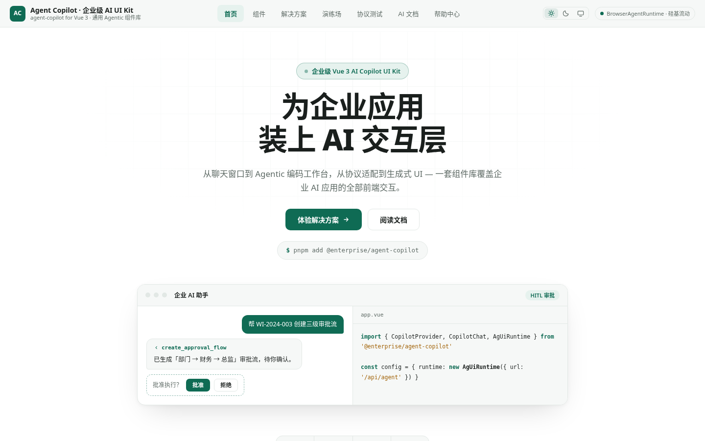
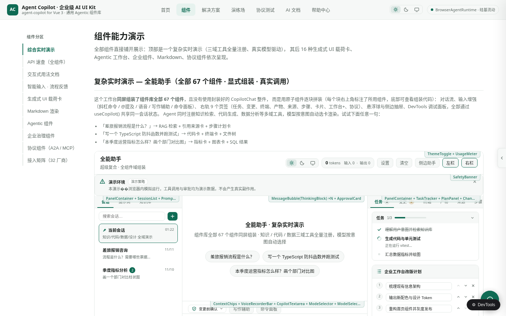
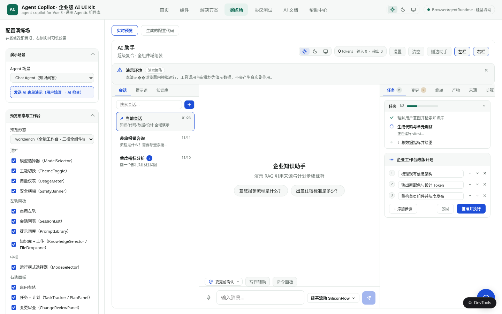
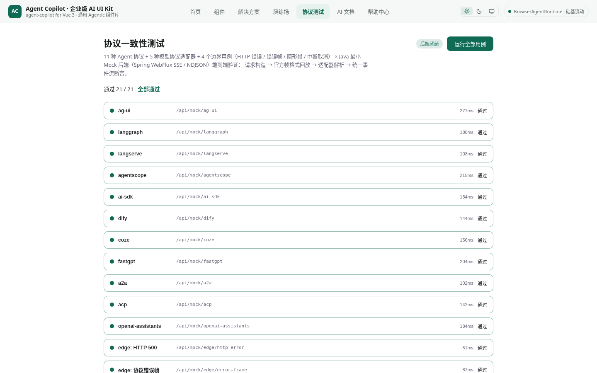

# agent-copilot

Enterprise AI Agent Copilot component library · Vue 3 · TypeScript

[简体中文](README.md) · **English**

A Vue 3 component library for enterprise AI assistants and agentic workbenches: **67 components**, **16 structured payload cards** and **30+ protocol presets** (model protocols / agent frameworks / interop protocols), with the AG-UI event-stream protocol, HITL (human-in-the-loop) interrupts, generative UI, multi-session management and a theme system built in — plus a Java reference backend and a full demo site.

> The demo site UI is in Chinese; the components themselves ship `zh-CN` and `en-US` locales. Screenshots below are from the real demo site.



## Features

- **Chat core**: four integration shapes — CopilotChat / CopilotSidebar / CopilotPopup / AgentCopilot — from a floating button to an all-in-one workbench
- **Agentic workbench**: execution step log, task / plan tracking (editable, with approval), change diff review, checkpoint rollback, a real terminal (ANSI parsing / command history), file and browser panels
- **Generative UI**: 16 structured payload cards (chart / table / code / diff / SQL / terminal / timeline / metrics / citation / comparison / audio-video / form, …) with custom payload renderer registration
- **Input enhancements**: slash commands, @ mentions, # references, attachments, voice, a deep-thinking toggle, AI writing assist (Tab completion), command palette
- **HITL**: tool approval cards, AI forms (16 controls + field validation + AI check loop), plan review, clarification cards
- **Protocol layer**: AG-UI event stream (26 event types), presets for OpenAI / Anthropic / DeepSeek / Qwen / A2A / MCP / ACP and 30+ more, with a browser-direct runtime or an HTTP backend runtime
- **Engineering quality**: focus-trap accessibility, virtualized long conversations, error-boundary fallbacks, 69 unit tests, strict vue-tsc types

## Quick start

### Start everything (recommended)

```bash
# Start all services: Java mock backend (:8080) + front-end demo site (:3000)
pnpm start:all

# Status / stop
pnpm status:all
pnpm stop:all
```

The script checks for and installs missing dependencies (JDK / node_modules / backend jar) and writes logs to `logs/`.

### Front end only

```bash
pnpm install    # pnpm 10+ required
pnpm dev        # http://localhost:3000
```

### Minimal example

```vue
<script setup lang="ts">
import { AgentCopilot } from '@/lib/agent-copilot'
</script>

<template>
  <AgentCopilot
    :config="{
      runtime: 'browser',
      model: 'deepseek-chat',
      locale: 'en-US',
      welcomeScreen: { title: 'Enterprise knowledge assistant' },
    }"
    title="AI Assistant"
    height="600px"
  />
</template>
```

For finer-grained composition (CopilotProvider + atomic components) see the demo site's "Components" page and `docs/COMPONENT_GUIDE.md`.

## Demo site tour

### Component gallery

All 67 components grouped into 11 domains, with a full API cheat sheet (props / events / slots / selection guidance) and a "complex live demo" — a three-column workbench that assembles all 67 components from atomic parts on one screen.



### Configuration playground

40+ options tuned live: preview shape (workbench / chat), per-panel toggles for the top bar / left rail / right rail, input enhancements, floating widgets and agentic behaviour policies, with the configuration code generated alongside.



### Protocol tests

A built-in protocol conformance bench covering AG-UI event-stream encoding/decoding, event ordering and interrupt/resume.



## Tech stack

- **Vue 3.5** + **TypeScript** + **Vite 6**, `vue-router`
- Rendering: `marked` (Markdown), `katex` (math), `mermaid` (diagrams)
- Tests and types: **Vitest**, **vue-tsc**
- Reference backends: `java-backend/` (Spring Boot / WebFlux, Maven) and `server/agent-backend.mjs` (Node, mounted as Vite middleware)
- Package manager: **pnpm 10+** (`pnpm-workspace.yaml` only declares `onlyBuiltDependencies`; pnpm 9 fails with `packages field missing or empty`)

## Project structure

```
├── src/lib/agent-copilot/     # the component library
│   ├── components/            # 67 components (chat / agentic / generative-ui / workspace / input / protocol / general / shell / devtools / textarea)
│   ├── composables/           # useCopilot / useTheme / useFocusTrap, …
│   ├── protocols/             # AG-UI event protocol + 30+ preset adapters
│   ├── i18n/                  # zh-CN / en-US locales, registerLocale
│   ├── types/                 # full TypeScript types
│   └── __tests__/             # 69 unit tests (incl. API-convention guard tests)
├── src/demo/                  # demo site (home / components / solutions / playground / protocol tests / AI docs / help)
├── java-backend/              # Java reference backend (Spring Boot, AG-UI aligned)
├── server/                    # Node agent backend (Vite middleware, real LLM + file + terminal tools)
├── scripts/start-all.sh       # one-command start script
└── docs/                      # component guide / reliability notes / screenshots
```

## Component API conventions

Every component follows the same rules (enforced by the `api-conventions.test.ts` guard test):

- explicit component names via `defineOptions({ name })`
- typed slots via `defineSlots` (with scoped payload types and JSDoc)
- dialogs use the `v-model:open` protocol
- key components expose programmatic controls via `defineExpose`
- every emit has JSDoc describing when it fires and its payload

## Backend integration

| Runtime | Description |
| --- | --- |
| `browser` | Calls the model API directly from the browser (demos / lightweight use) |
| `http` | Connects to any backend that implements the AG-UI event stream |

Reference implementations: `java-backend/` (Spring Boot) and `server/agent-backend.mjs` (Node, with a real file / terminal tool sandbox). The event protocol contract lives in the `java-backend/src/` implementation and `src/lib/agent-copilot/protocols/`.

## Configuration

| Setting | Description |
| --- | --- |
| `config.runtime` | `browser` (direct model API from the browser) or `http` (AG-UI event-stream backend) |
| `config.model` | Model name, e.g. `deepseek-chat` |
| `config.locale` | UI language: `zh-CN` (`zh`) / `en-US` (`en`); extend with `registerLocale` |
| `AI_GATEWAY_API_KEY` | Environment variable the Node agent backend (`server/agent-backend.mjs`) needs to call a real LLM (Vercel AI Gateway, OpenAI-compatible); without it the backend emits `RUN_ERROR` |
| Ports | `pnpm dev` serves the front end on `:3000`; `pnpm start:all` also starts the Java backend on `:8080` |

See the demo site's "Playground" page and `docs/COMPONENT_GUIDE.md` for every option.

## Development

```bash
pnpm exec vue-tsc --noEmit     # type check
pnpm exec vitest run           # unit tests
pnpm build                     # build
```

## Contributing

Issues and pull requests are welcome. Please run `pnpm exec vue-tsc --noEmit` and `pnpm exec vitest run` before submitting; new components must follow the component API conventions above (checked automatically by `api-conventions.test.ts`).

## License

MIT
