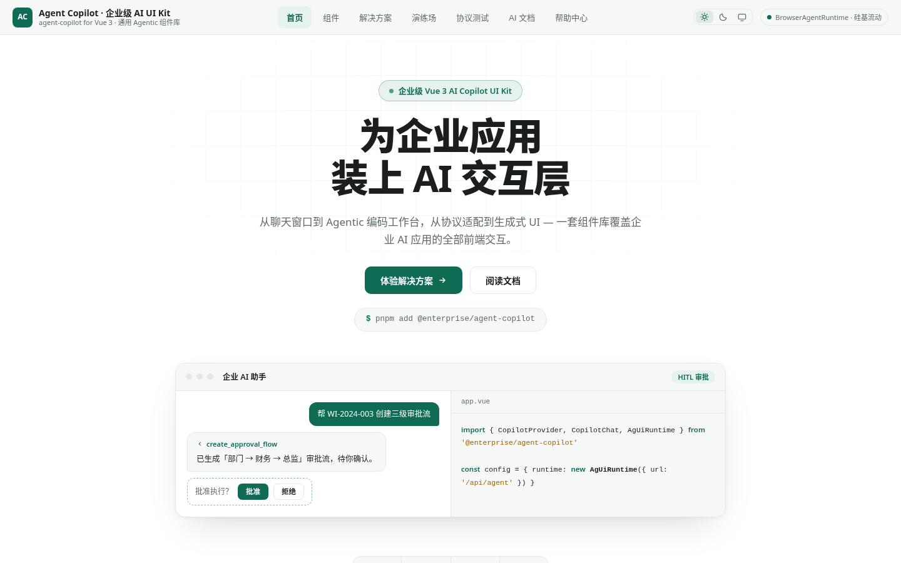
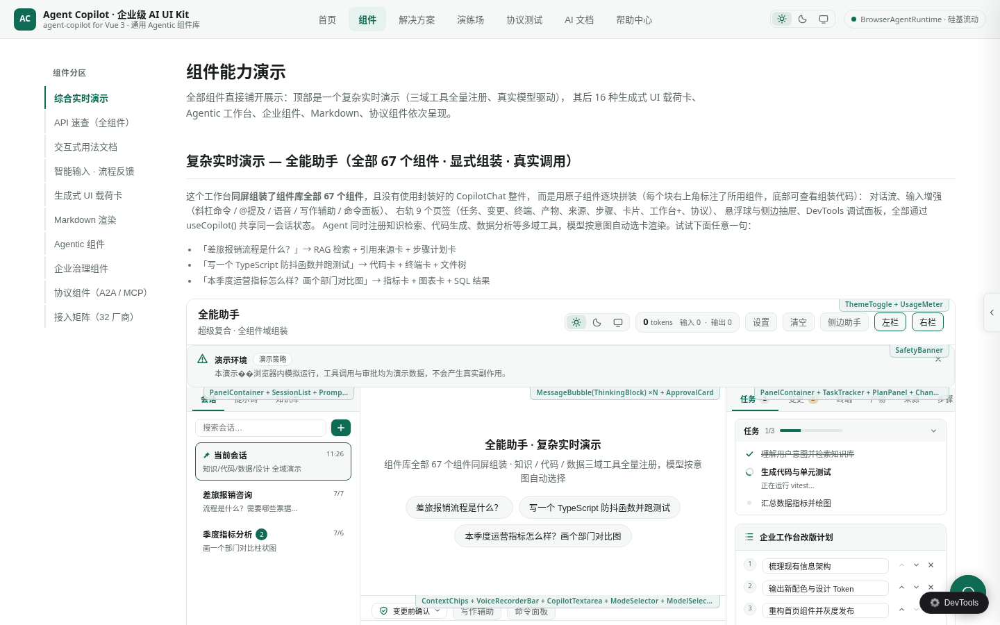
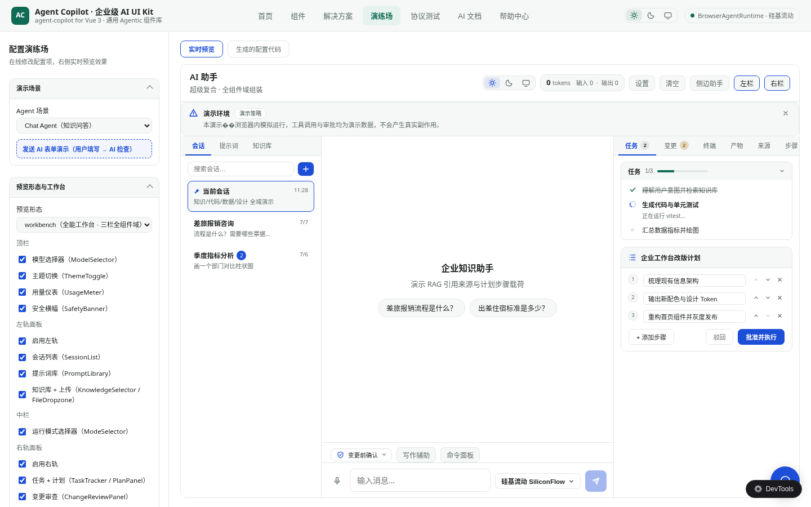
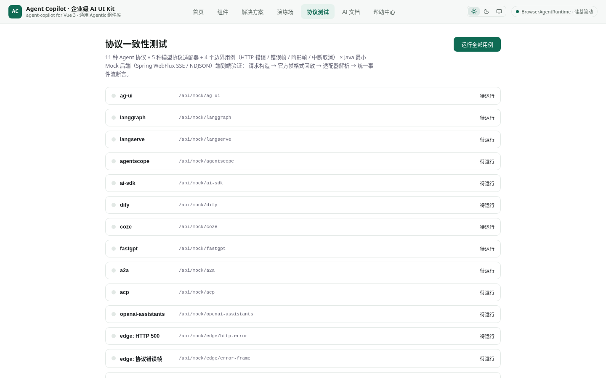

# agent-copilot

企业级 AI Agent Copilot 组件库 · Vue 3 · TypeScript

一套面向企业 AI 助手 / Agentic 工作台场景的 Vue 3 组件库：**67 个组件**、**16 种结构化载荷卡**、**30+ 协议预设**（模型协议 / Agent 框架 / 互操作协议），内置 AG-UI 事件流协议、HITL 人机协同中断、生成式 UI、多会话管理与主题系统，并附带 Java 参考后端与完整演示站。



## 功能特性

- **对话核心**：CopilotChat / CopilotSidebar / CopilotPopup / AgentCopilot 四种接入形态，从悬浮球到一体化工作台
- **Agentic 工作台**：执行步骤日志、任务/计划跟踪（可编辑审批）、变更 Diff 审查、检查点回滚、真实终端（ANSI 解析 / 命令历史）、文件与浏览器面板
- **生成式 UI**：16 种结构化载荷卡（图表 / 表格 / 代码 / Diff / SQL / 终端 / 时间线 / 指标 / 引用 / 对比 / 音视频 / 表单等），支持自定义载荷渲染器注册
- **输入增强**：斜杠命令、@ 提及、# 引用、附件、语音、深度思考开关、AI 写作辅助（Tab 续写）、命令面板
- **HITL 人机协同**：工具审批卡、AI 表单（16 种控件 + 字段校验 + AI 检查闭环）、计划审查、澄清卡
- **协议层**：AG-UI 事件流（26 种事件），适配 OpenAI / Anthropic / DeepSeek / Qwen / A2A / MCP / ACP 等 30+ 预设，浏览器直连或 HTTP 后端两种运行时
- **工程质量**：焦点圈定无障碍、长会话虚拟化、错误边界降级、69 项单测、vue-tsc 严格类型

## 快速开始

### 一键启动（推荐）

```bash
# 启动全部服务：Java Mock 后端（:8080）+ 前端演示站（:3000）
pnpm start:all

# 查看状态 / 停止
pnpm status:all
pnpm stop:all
```

脚本会自动检查并安装缺失的依赖（JDK / node_modules / 后端 jar），日志输出到 `logs/`。

### 仅前端

```bash
pnpm install
pnpm dev        # http://localhost:3000
```

### 最小接入示例

```vue
<script setup lang="ts">
import { AgentCopilot } from '@/lib/agent-copilot'
</script>

<template>
  <AgentCopilot
    :config="{
      runtime: 'browser',
      model: 'deepseek-chat',
      welcomeScreen: { title: '企业知识助手' },
    }"
    title="AI 助手"
    height="600px"
  />
</template>
```

更细粒度的拼装（CopilotProvider + 原子组件）见演示站「组件」页与 `docs/COMPONENT_GUIDE.md`。

## 演示站导览

### 组件画廊

67 个组件按 11 个域分组展示，附全组件 API 速查（Props / 事件 / 插槽 / 选型指导）与「复杂实时演示」——不用封装整件、以原子组件同屏组装全部 67 个组件的三栏工作台。



### 配置演练场

40+ 配置项实时调参：预览形态（工作台 / 对话）、顶栏 / 左轨 / 右轨逐面板开关、输入增强、悬浮组件、Agentic 行为策略，右侧同步生成配置代码。



### 协议测试

内置协议一致性测试台，覆盖 AG-UI 事件流的编解码、事件顺序与中断恢复。



## 目录结构

```
├── src/lib/agent-copilot/     # 组件库本体
│   ├── components/            # 67 个组件（chat / agentic / generative-ui / workspace / input / protocol / general / shell / devtools / textarea）
│   ├── composables/           # useCopilot / useTheme / useFocusTrap 等
│   ├── protocols/             # AG-UI 事件协议 + 30+ 预设适配
│   ├── types/                 # 全量 TypeScript 类型
│   └── __tests__/             # 69 项单测（含 API 约定守护测试）
├── src/demo/                  # 演示站（首页 / 组件 / 解决方案 / 演练场 / 协议测试 / AI 文档 / 帮助）
├── java-backend/              # Java 参考后端（Spring Boot，AG-UI 协议对齐）
├── server/                    # Node Agent 后端（Vite 中间件，真实 LLM + 文件 + 终端工具）
├── scripts/start-all.sh       # 一键启动脚本
└── docs/                      # 组件指南 / 可靠性文档 / 截图
```

## 组件 API 约定

全部组件遵循统一规范（由 `api-conventions.test.ts` 守护测试强制）：

- `defineOptions({ name })` 显式组件名
- `defineSlots` 类型化插槽（含作用域载荷类型与 JSDoc）
- 对话框统一 `v-model:open` 协议
- 关键组件 `defineExpose` 程序化控制口
- emits 逐条 JSDoc 注释触发时机与载荷

## 后端接入

| 运行时 | 说明 |
| --- | --- |
| `browser` | 浏览器直连模型 API（演示 / 轻量场景） |
| `http` | 对接任意实现 AG-UI 事件流的后端 |

参考实现：`java-backend/`（Spring Boot）与 `server/agent-backend.mjs`（Node，真实文件 / 终端工具沙箱）。事件协议契约见 `java-backend/README.md`。

## 开发

```bash
pnpm exec vue-tsc --noEmit     # 类型检查
pnpm exec vitest run           # 单元测试
pnpm build                     # 构建
```

## License

MIT
