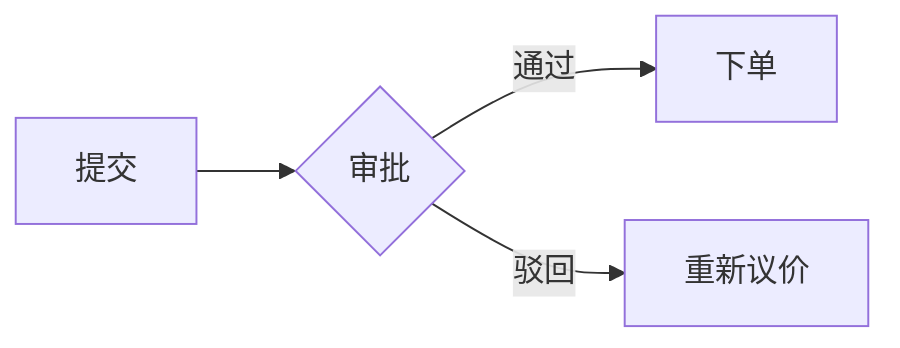

# Markdown 渲染能力

[demo:markdown-live]

`MarkdownText` 组件（消息气泡默认渲染器）支持的全部语法与扩展。

## 基础语法

标题、粗体/斜体、列表、表格、链接、图片、引用块、分隔线、行内代码——标准 GFM 全支持。表格自动包裹横向滚动容器并提供「复制表格」按钮（TSV 格式，可直接粘贴到 Excel）。

## 数学公式（KaTeX）

行内公式用 `$...$`，块级公式用 `$$...$$`：

```text
质能方程 $E=mc^2$ 表明……

$$
\int_{-\infty}^{\infty} e^{-x^2} dx = \sqrt{\pi}
$$
```

流式输出期间公式源码原样显示，本轮生成结束后统一渲染，避免半截公式导致的渲染错误。

## 流程图（Mermaid）

````text

````

支持 flowchart、sequenceDiagram、gantt、pie 等全部 Mermaid 图表类型。语法错误时降级为源码展示，不阻断整条消息。

## 代码块增强

````text
```ts filename=api/client.ts line-numbers
export async function fetchOrders() {
  return fetch('/api/orders').then((r) => r.json())
}
```
````

- **头部栏**：显示语言标识和可选的 `filename=`；
- **一键复制**：头部复制按钮；
- **行号**：加 `line-numbers` 标记；
- **diff 着色**：语言用 `diff`，`+`/`-` 行自动着色。

## GitHub 警告块（Admonitions）

```text
> [!NOTE]
> 一般性补充说明。

> [!WARNING]
> 需要注意的风险。

> [!CAUTION]
> 危险操作警告。
```

支持 `NOTE` / `TIP` / `IMPORTANT` / `WARNING` / `CAUTION` 五种，左侧色条 + 标题着色。

## 任务列表

```text
- [x] 完成提交
- [ ] 等待审批
```

## 脚注

```text
正文引用[^1]。

[^1]: 脚注内容。
```

## 折叠块

```html
<details>
<summary>点击展开完整报价明细</summary>

明细内容……

</details>
```

## 安全性

所有 HTML 输出经过白名单过滤（基于 DOMPurify），`<script>`、事件属性、`javascript:` 链接一律移除；外链自动加 `rel="noopener noreferrer"`。
